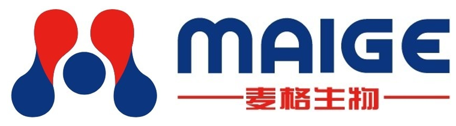

# MAIGE Global B2B Website



This Next.js site recreates the supplied MAIGE homepage composition and provides four localized site trees (`/en`, `/ar`, `/ru`, `/es`). Source code is in [`laike2026/maigebio.com`](https://github.com/laike2026/maigebio.com), linked to the `maigebio-com` Vercel project in the laike2026 account.

## Run locally

With Node.js 20.9+ and pnpm:

```bash
pnpm install
pnpm dev
```

Open `http://127.0.0.1:3000/en`. Check changes with `pnpm typecheck`, `pnpm test`, `pnpm build` and, while the server is running, `pnpm test:e2e`.

## Enquiries

The production form validates submissions server side and sends a plain-text notification through Resend to `info@maigebio.com`. The sender defaults to `MAIGE Website <inquiries@maigebio.com>`. The Resend integration supplies `RESEND_API_KEY` as a sensitive Production variable; `INQUIRY_FROM_EMAIL` and `INQUIRY_TO_EMAIL` can override the defaults. The sending domain needs Resend DNS verification. The API returns an error if Production lacks the key or delivery fails, so the form does not falsely claim success. WhatsApp contact uses the user-supplied QR destination behind short labels.

Local development without a Resend key appends enquiries to ignored `.data/inquiries.jsonl` and labels the result as local only. Do not put the key in the repository.

## Analytics and search

GA4 uses `NEXT_PUBLIC_GA_MEASUREMENT_ID` and loads only after visitor opt-in. It sends page views without URL query strings and a `generate_lead` event after confirmed email delivery. Visitors can change their choice through the Analytics settings control. The MAIGE GA4 measurement ID is `G-MN1LN6LZ18`.

For future server-side GA4 reporting, the service account credential is stored as Vercel Production-only `GOOGLE_SERVICE_ACCOUNT_JSON`; `GA4_PROPERTY_ID=558913614`. Local development can use ignored `GOOGLE_APPLICATION_CREDENTIALS=.secrets/ga4-service-account.json`. Never expose either server credential in `NEXT_PUBLIC_*`.

Set `NEXT_PUBLIC_SITE_URL=https://maigebio.com` and `NEXT_PUBLIC_INDEXABLE=true` in Production for canonical metadata, robots and sitemap. Other environments can remain non-indexable.

## Assets and content

- `public/images/brand/maige-logo.jpg` is the user-provided brand image.
- `scripts/generate-brand-assets.mjs` exports favicon, mobile, horizontal lockup and social cards directly from that official image; the logo itself is not redrawn. Run it after replacing the source with an approved higher-resolution master.
- `public/images/brand/maige-social.png` is the website sharing image; `maige-github-preview.png` is the GitHub repository social preview upload file.
- `public/images/products/*-illustration.png` are generic illustrations, not product photographs.
- `public/images/reference/home-reference.png` is the user-provided design screenshot; its visual crops are illustrative until original company photography is supplied.

See [`docs/content-gaps.md`](docs/content-gaps.md) for source material still needed to expand verified company and product content.
